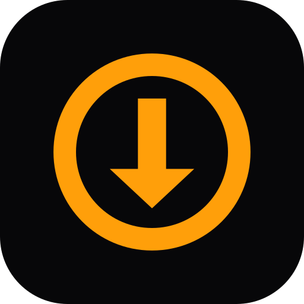
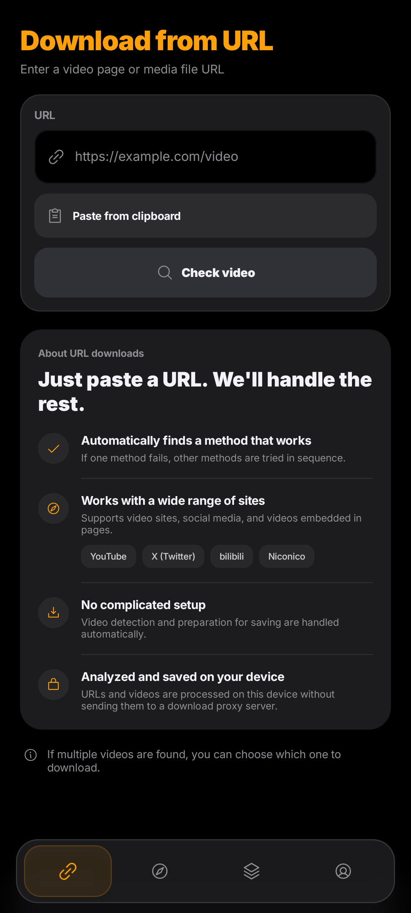
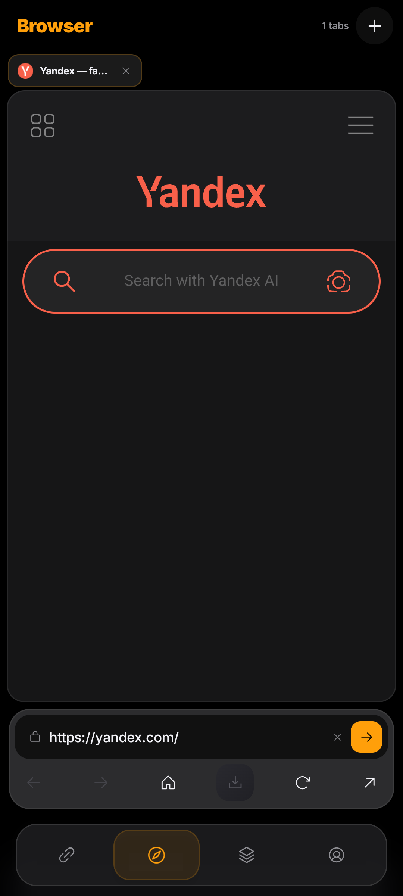
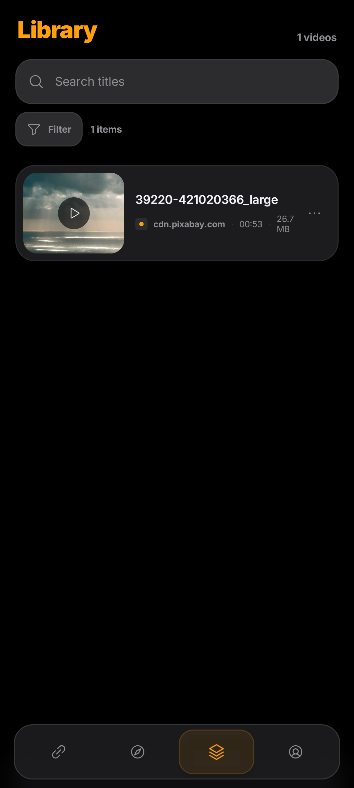
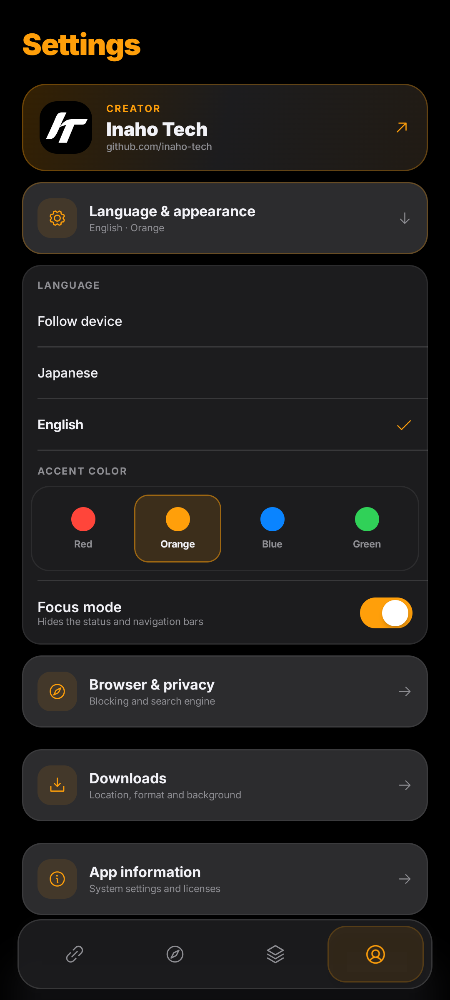

<p align="center">
  
</p>
<h1 align="center">Veiload</h1>
<p align="center">
  <strong>プライバシーに配慮。複数の取得方式。非常に高いダウンロード成功率。</strong><br>
  端末内で動画を解析し、yt-dlp・直接取得・ページ内検出・FFmpegを自動で切り替えるAndroid動画ダウンローダーです。
</p>
<p align="center">日本語 · <a href="README.md">English</a></p>
<p align="center">
  
  
  
  
</p>
<p align="center">
  <a href="https://github.com/inaho-tech/veiload/releases"></a>
</p>

## スクリーンショット

<table>
  <tr>
    <td align="center"><br><sub>URLダウンロード</sub></td>
    <td align="center"><br><sub>ブラウザー</sub></td>
    <td align="center"><br><sub>ライブラリー</sub></td>
  </tr>
  <tr><td align="center"><br><sub>マイページ</sub></td></tr>
</table>

## Veiloadについて

Veiloadは、動画ページの閲覧、メディア検出、保存、ライブラリー管理、再生までをひとつにまとめたAndroidアプリです。yt-dlpとFFmpegを端末内で実行し、URLや動画をVeiload独自のダウンロード代行サーバーへ送りません。

Veiloadアカウントや登録は不要です。広告SDK、アクセス解析SDK、クラッシュ収集SDKを組み込んでいません。保存したファイルは `Downloads/Veiload` に置かれ、利用者自身が管理できます。

Veiloadは、**非常に高いダウンロード成功率**を目指して設計されています。ひとつの方式で保存できない場合も、yt-dlpによる抽出、ブラウザー上のメディア検出、動画ファイルの直接取得、HLS/DASH向けのFFmpeg処理など、利用可能な取得方法を自動で順番に試します。

## プライバシーを中心にした設計

- メディア解析とファイル処理を端末内で実行
- Veiload独自のダウンロード代行サーバーやクラウド保存を不使用
- アカウント、登録、Veiloadへのログインが不要
- アクセス解析、広告、アプリ横断追跡SDKを不使用
- メタデータは動画と同じ保存先で管理し、動画が外部削除された場合も自動清掃
- アプリ内ブラウザーでEasyList / EasyPrivacyによる広告・追跡対策を利用可能
- フォーカスモードでAndroidのシステムバーを非表示に設定可能

完全なオフラインアプリではありません。閲覧先サイト、選択した検索エンジン、ダウンロードに必要な配信元、フィルターリスト提供元、更新確認用のGitHub Releasesには通信します。各サービスにはそれぞれのプライバシー方針があります。

## 主な機能

### URLから動画を解析

- 複数の取得方式を自動で試すことによる非常に高い成功率
- 動画ページ、MP4、HLS、DASHなどのURLを解析
- 複数動画を検出した場合の選択ダウンロード
- yt-dlp、直接取得、FFmpegを利用した自動フォールバック
- 最大3件の同時ダウンロード、進捗表示、キャンセル

### アプリ内ブラウザー

- 複数タブ、検索、戻る・進む、ホーム、再読み込み
- 表示中ページから動画候補を検出
- EasyList / EasyPrivacyを利用したブロック機能
- 要素非表示と動画広告ブロックを個別設定

### ライブラリーと再生

- サムネイル、配信元、長さを含む動画一覧
- タイトル、サイト、動画時間による絞り込み
- アプリ内再生、共有、削除
- アプリ外で動画を削除した場合の孤立メタデータ自動清掃

### 設定と操作

- 日本語、英語、端末言語への追従
- 4色のアクセントカラー
- ステータスバーとナビゲーションバーを隠すフォーカスモード
- 指に追従するスワイプ対応タブナビゲーション
- GitHub Releasesを利用したアプリ内アップデート

## プロジェクト構成

```text
.
├── app/                 Androidアプリ（Kotlin / Jetpack Compose）
├── assets/              README用アセット
├── screen-shot/         Android版スクリーンショット
└── gradle/              Androidビルド設定
```

## ビルド

必要なもの:

- Android Studio
- JDK 17
- Android SDK 36

```powershell
.\gradlew.bat assembleDebug
```

APKは `app/build/outputs/apk/debug/app-debug.apk` に生成されます。yt-dlp、Python、FFmpegのネイティブコンポーネントを内包するため、一般的なUIアプリよりファイルサイズが大きくなります。

## アップデート

起動時に [GitHub Releases](https://github.com/inaho-tech/veiload/releases) を確認します。新しいバージョンがある場合はGitHubからAPKを直接取得し、Androidのパッケージインストーラーを開きます。初回のみ、利用者自身が「この提供元のアプリを許可」を有効にする必要があります。

## 注意事項

ダウンロード対象サイトの利用規約と著作権を確認し、保存する権利のあるコンテンツにのみ使用してください。サイト側の仕様変更により、一部の動画を検出・保存できなくなる場合があります。

## ライセンス

Copyright (C) 2026 Inaho Tech.

Veiloadは **GNU General Public License v3.0 only**（`GPL-3.0-only`）で提供される自由ソフトウェアです。完全な条件は[LICENSE](LICENSE)を参照してください。公開APKに対応するソースコードは、同じバージョンのGitHub Releaseタグから取得できます。

同梱ライブラリーと実行環境に必要な表記・ライセンス本文は[third_party_licenses](third_party_licenses)に収録し、APK内にも同梱しています。Veiload内では「アプリ情報」から確認できます。

## 作者

[Inaho Tech](https://github.com/inaho-tech)
