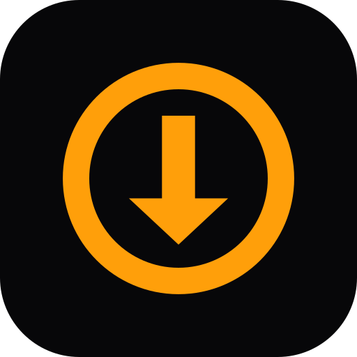
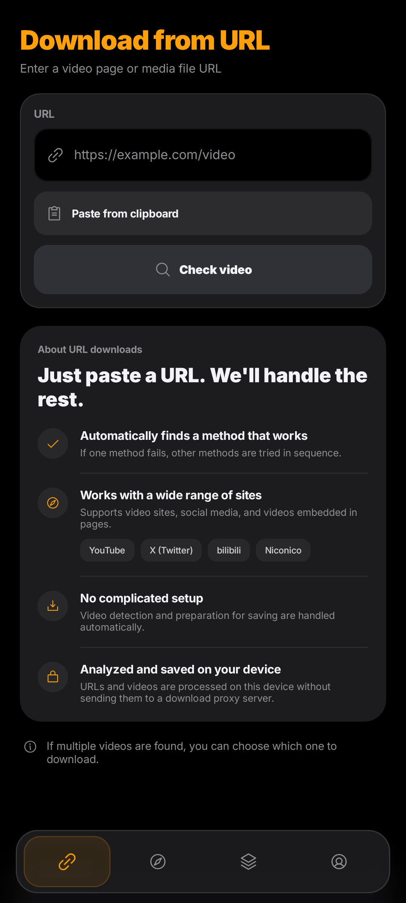
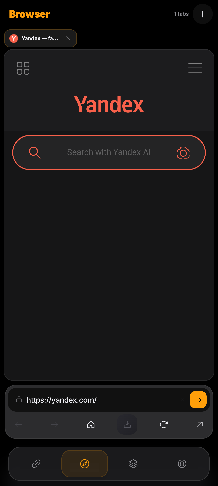
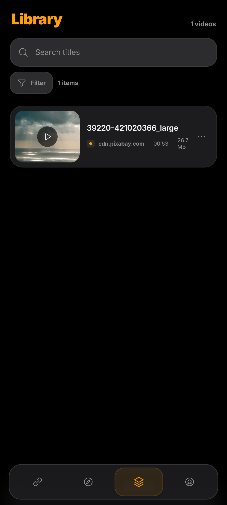
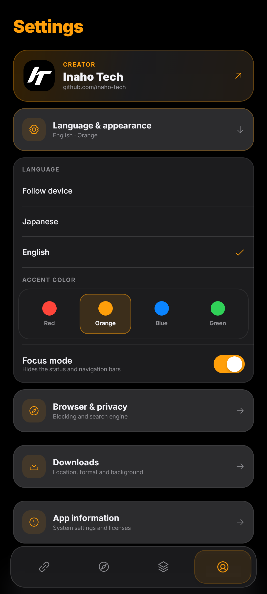

<p align="center">
  
</p>
<h1 align="center">Veiload</h1>
<p align="center">
  <strong>Private by design. Multiple download methods. A very high success rate.</strong><br>
  An Android video downloader that analyzes media on-device and automatically falls back between yt-dlp, direct extraction, page detection, and FFmpeg.
</p>
<p align="center"><a href="README.ja.md">日本語</a> · English</p>
<p align="center">
  
  
  
  
</p>
<p align="center">
  <a href="https://github.com/inaho-tech/veiload/releases"></a>
</p>

## Screenshots

<table>
  <tr>
    <td align="center"><br><sub>URL download</sub></td>
    <td align="center"><br><sub>Browser</sub></td>
    <td align="center"><br><sub>Library</sub></td>
  </tr>
  <tr>
    <td align="center"><br><sub>Settings</sub></td>
  </tr>
</table>

## About Veiload

Veiload combines browsing, media detection, downloading, library management, and playback in one Android app. It runs yt-dlp and FFmpeg locally. Video URLs and media are not sent to a Veiload-operated proxy or download server.

No Veiload account is required. The app contains no advertising SDK, analytics SDK, or crash-reporting SDK. Saved files remain under your control in `Downloads/Veiload`.

Veiload is designed for a **very high download success rate**. If one method cannot save a video, it automatically tries other available paths—including yt-dlp extraction, browser-side media detection, direct file retrieval, and FFmpeg processing for HLS/DASH streams.

## Privacy by design

- Media extraction and file processing run on the device.
- No Veiload-operated download proxy or cloud media storage.
- No account, registration, or sign-in with Veiload.
- No analytics, advertising, or cross-app tracking SDK.
- Download metadata stays alongside the saved media and is cleaned when its media file is removed.
- Ad and tracker blocking can use EasyList / EasyPrivacy rules in the in-app browser.
- Focus mode can hide Android system bars while the app is in use.

Veiload is not fully offline: network requests are made to pages you visit, the search engine you select, media hosts needed for downloads, filter-list providers, and GitHub Releases for update checks. Those services have their own privacy practices.

## Features

### Analyze video URLs

- Very high success rate through multiple automatic download methods
- Analyze video pages, MP4, HLS, DASH, and other media URLs
- Choose from multiple detected videos
- Automatic fallback between yt-dlp, direct download, and FFmpeg
- Up to three simultaneous downloads with progress and cancellation

### In-app browser

- Multiple tabs, search, back/forward, home, and reload
- Detect media candidates from the current page
- EasyList / EasyPrivacy-powered blocking controls
- Separate controls for cosmetic filtering and video-ad blocking

### Library and playback

- Video list with thumbnails, source sites, and durations
- Filter by title, site, and duration
- In-app playback, sharing, and deletion
- Automatic cleanup of orphaned metadata after external file deletion

### Settings and interaction

- English, Japanese, or follow-device language
- Four accent colors
- Focus mode that hides status and navigation bars
- Swipeable tab selector that follows the pointer
- In-app updates from GitHub Releases

## Project structure

```text
.
├── app/                 Android app (Kotlin / Jetpack Compose)
├── assets/              README assets
├── screen-shot/         Android screenshots
└── gradle/              Android build configuration
```

## Build

Requirements:

- Android Studio
- JDK 17
- Android SDK 36

```powershell
.\gradlew.bat assembleDebug
```

The APK is generated at `app/build/outputs/apk/debug/app-debug.apk`. It is larger than a typical UI app because it bundles yt-dlp, Python, and FFmpeg native components.

## Updates

Veiload checks [GitHub Releases](https://github.com/inaho-tech/veiload/releases) at startup. When a newer version exists, it can download the APK directly from GitHub and open Android's package installer. Android requires the user to explicitly allow installs from Veiload the first time.

## Responsible use

Only download content you have the right to save. Follow the target site's terms and applicable copyright law. Site changes may occasionally break media detection or downloading.

## Third-party licenses

Licenses for bundled libraries, runtimes, and filter lists are available under **App information** inside Veiload.

## Author

[Inaho Tech](https://github.com/inaho-tech)
